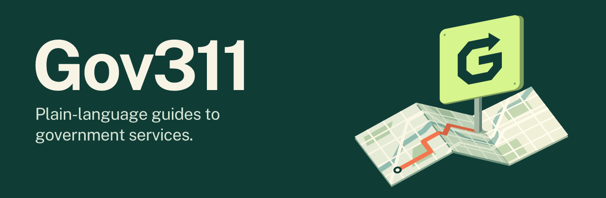

# 

Many cities have a 311 line for questions about local services. Gov311 brings that idea to AI chat. Ask where to apply for food assistance, who issues a building permit, or how to tell whether a bill became law. Each guide points you to the government office or public record behind the answer.

Gov311 is a community project covering Tennessee state government, Metro Nashville, Knox and Polk counties and their municipalities, and selected federal services. All 95 Tennessee counties also have a property guide. Choose your county for its parcel map, tax records, elected officials and school contacts. [Find your county’s property guide](data/us/tn/_state/services/find-a-property-map.md#county-guides)

You can use the guides in a chat or read them yourself. The guides are independent of the agencies they describe.

## Ask in ChatGPT, Claude, or Grok Bot

Open a chat in the app you already use. These steps use the public guides and require no Gov311 installation.

| Your app | Where to start |
| --- | --- |
| [ChatGPT](https://chatgpt.com/) | Start a new chat. To have ChatGPT look up the official pages, choose **Search** under **View all tools**, or ask it to search the web in your message. [ChatGPT search help](https://help.openai.com/en/articles/9237897-searching-the-web-with-chatgpt) |
| [Claude](https://claude.ai/) | Start a new chat. If your **+** menu has a **Web search** option, turn it on so Claude can open the guide links. Newer versions search automatically. [Claude web search help](https://support.claude.com/en/articles/10684626-enable-and-use-web-search) |
| [Grok Bot](https://x.ai/bot) | Open your Bot from the sidebar and paste the message into its chat. You can also use the message in an ordinary [Grok chat](https://grok.com/). [Grok Bot messaging help](https://docs.x.ai/grok-bot/chat-and-collaboration) |

Copy this message into your chat. Try the example as written, or replace the last paragraph with your own question. Include your city or county when asking about a local service.

```text
Read the Gov311 instructions here.
https://raw.githubusercontent.com/appalachios/gov311/main/skills/gov311/SKILL.md
Find the guide in this index.
https://raw.githubusercontent.com/appalachios/gov311/main/llms.txt

Open the matching guide and check its official sources. Link me to
the pages that support the answer. Include the guide’s trust level,
who checked it, when, and anything they could not confirm.

In Tennessee, where can I see what lawmakers are considering?
How can I tell whether an amendment changed the bill I'm reading?
```

If the chat cannot open the index, open a guide yourself. Select **Raw** on its GitHub page, copy the text into your chat, and ask your question. You can also follow the official links yourself. If the assistant cannot open an official page, paste the passage you want explained. [Track a Tennessee bill](data/us/tn/_state/services/track-a-bill.md) · [Read a caption bill and its amendments](data/us/tn/_state/services/read-a-caption-bill.md) · [Find a Tennessee state office](data/us/tn/_state/contacts/state-government-directory.md) · [Browse all guides](data)

### Save a skill for next time

Start with **Gov311** if you’re unsure which office to ask. You can also save either of the other skills on its own.

| Skill | When to use it | Files |
| --- | --- | --- |
| Gov311 | “I live outside Benton. Is this a city, county, or state question?” | [Instructions](https://raw.githubusercontent.com/appalachios/gov311/main/skills/gov311/SKILL.md) · [Claude ZIP](assets/gov311-skill.zip) |
| Gov311 Services | “Who takes my property tax payment in Polk County?” | [Instructions](https://raw.githubusercontent.com/appalachios/gov311/main/skills/gov311-services/SKILL.md) · [Claude ZIP](assets/gov311-services-skill.zip) |
| Gov311 Laws | “How can I tell whether Ducktown passed the ordinance on its agenda?” | [Instructions](https://raw.githubusercontent.com/appalachios/gov311/main/skills/gov311-laws/SKILL.md) · [Claude ZIP](assets/gov311-laws-skill.zip) |

- **ChatGPT.** If your Business, Enterprise, Healthcare, or Edu workspace has skills enabled, open **Plugins → Skills → Create → Create with chat**. Send the message below, then select **Install** when prompted. [ChatGPT skills help](https://help.openai.com/en/articles/20001066-skills-in-chatgpt)
- **Claude.** Download the **Claude ZIP** for the skill you want from the table above. If GitHub opens a file page, select **View raw** to download it. In Claude, open **Customize → Skills → + → Create skill → Upload a skill**. Choose the ZIP and turn on that skill. Repeat for any others you want. This requires code execution and file creation to be enabled in your account or workspace. [Claude skills help](https://support.claude.com/en/articles/12512180-use-skills-in-claude)
- **Grok Bot.** Send the message below to your Bot to save a private skill. You can then ask for it by name. [Grok Bot skills help](https://docs.x.ai/grok-bot/skills-routines-and-automations)

```text
Save a personal skill named Gov311. Use the instructions in
https://raw.githubusercontent.com/appalachios/gov311/main/skills/gov311/SKILL.md
Keep the link to the public guide index so you can look up the guide
each time I ask a question.
```

To save Gov311 Services or Gov311 Laws, replace the name and link in that message with the ones from its row. In a new chat, try “Use Gov311 Laws to help me find a proposed ordinance.”

### Ask about Knox County, Tennessee

For a Knoxville mailing address, look up the parcel in **KGIS Maps** and check whether it is inside Knoxville, inside Farragut or in unincorporated Knox County. Part of Farragut lies in Loudon County. For a parcel on that side, select **Loudon** in the Tennessee Property Viewer. [Open KGIS Maps](https://www.kgis.org/kgismaps/map.htm) · [Find your county’s property map](data/us/tn/_state/services/find-a-property-map.md) · [Official municipal boundaries](https://comptroller.tn.gov/office-functions/pa/gisredistricting/municipal-boundaries.html)

Try “Does the vote on my Knoxville rezoning application settle it?” or “Where can I get a deed for the Loudon County part of Farragut?” [Knox County](data/us/tn/knox-county) · [Knoxville](data/us/tn/knoxville) · [Farragut](data/us/tn/farragut) · [Loudon County land records](data/us/tn/loudon-county/services/find-property-records.md)

### Ask about Polk County, Tennessee

If you live in [Benton](data/us/tn/benton), [Copperhill](data/us/tn/copperhill), or [Ducktown](data/us/tn/ducktown), tell the assistant which city. If you live outside city limits, start with [Polk County](data/us/tn/polk-county). A Benton mailing address alone doesn’t tell you whether you live inside Benton. The guides help you find which office handles the particular road, bill, or public record.

## Who Gov311 is for

### People who need help now

If you need food, housing, health coverage, or help paying bills, the hard part is often finding which office handles it and what to bring. Gov311 tells you who to contact first and what to have ready.

Things you can ask:

- "I just lost my job. What help can I apply for, and where do I start?"
- "Who do I call in Nashville when I need help with rent?"
- "What is 211, and what happens when I call it?"

In an emergency, call 911. Gov311 covers non-emergency services.

### Renters

Your protections as a renter come mostly from state law, and they are hard to find and hard to read. Gov311 points the assistant to the law itself, to plain-language guides from legal aid organizations, and to free legal help near you.

Things you can ask:

- "My landlord gave me an eviction notice. How much time do I have, and who can help me for free?"
- "My landlord will not fix the heat. What does Tennessee law require?"
- "What are the rules for getting my security deposit back?"

The assistant can explain what the official sources say. A lawyer or tenant advocate can tell you how the law applies to your situation, and Gov311 tells you how to reach one.

### Homeowners

Most home projects raise the same questions. Do you need a permit? What does it cost? Can you do the work yourself? Who inspects it?

Things you can ask:

- "Do I need a permit to build a deck in Nashville?"
- "How do I apply for a building permit for my own house?"
- "Who do I report a problem to on my street?"

### Nonprofits

Grants, registrations, and permits each have their own system and their own deadlines. Gov311 lays out the steps in order, including the ones that take weeks, so that you can start them early.

Things you can ask:

- "What do we need to set up before we can apply for a federal grant?"
- "Does our nonprofit have to register with the state before we ask for donations in Tennessee?"
- "How long does it take to register in SAM.gov, and what does it cost?"

### Builders, architects, and contractors

Every jurisdiction adopts its own editions of the building codes and adds its own amendments. Gov311 tells you where a jurisdiction publishes the codes it enforces, where the local amendments and the zoning map are, and which office to call with a question.

Things you can ask:

- "Which edition of the residential code does Nashville enforce?"
- "Where is the official zoning map for Davidson County?"
- "What does the plan review process look like for a residential addition?"

Gov311 points to the code. It does not restate the code. Confirm the requirement in the official text before you design or build to it.

### Small business owners

Tennessee business owners can [form an LLC](data/us/tn/_state/services/form-tennessee-llc.md), [register for business tax](data/us/tn/_state/services/register-for-business-tax.md), or [find state contracts open for bids](data/us/tn/_state/services/bid-on-state-contracts.md).

### People following state legislation

To see what Tennessee lawmakers are considering, [find a pending bill](data/us/tn/_state/services/track-a-bill.md) or [look up a hearing](data/us/tn/_state/services/find-legislative-hearings.md). The [guide to how a bill becomes law](data/us/tn/_state/services/legislative-process.md) explains which decisions still lie ahead.

A bill can keep its title while an amendment replaces its contents. One Tennessee education bill started with a proposal about parent-teacher engagement and became a law about school discipline. [Follow the amendments and votes](data/us/tn/_state/services/read-a-caption-bill.md) or [learn how to read an enacted public chapter](data/us/tn/_state/services/read-a-public-chapter.md).

### Everyone else

Voting, taxes, records, parking tickets, and trash pickup all belong here too. If your government does it, a guide to it can live in Gov311.

## What a good answer looks like

For a service question, the answer should name the office that handles it, tell you what to do first, and link to the form or contact page. For a bill, it should link to the legislature’s record so you can read the version under discussion. Check the official page before relying on a fee, a filing deadline, or a bill’s status.

Look for the name of the person or tool that checked the guide, the date, and the guide’s trust level. If Gov311 has no guide for your question, the assistant should say so and identify any official pages it found separately.

### How to read the trust level

| Label on a guide | What it tells you |
| --- | --- |
| `draft` | The guide has a research date. Its source check is incomplete. |
| `source-checked` | A named person or tool checked the guide’s claims against the cited official sources on the date shown. |
| `community` | A community contributor checked the guide. |
| `verified` | A second person independently confirmed the guide. |
| `official` | An employee of the government covered by the guide submitted or confirmed it. |

When two pages disagree, Gov311 checks the law or the office’s current filing instructions and links to the record that settles the question. A human review note tells you which detail still needs confirmation after that check and where to get it. A guide more than a year past its research or review date carries a warning.

If a government site asks for visitor verification, an assistant with browser access can complete the normal check with your permission when the site and browser allow it. If the site needs you to respond, the assistant can use another official copy or give you the link and section to open. For advice about how a law applies to your situation, a local legal aid office can help.

## Add your community

You know how your local government works better than any AI does. If you have figured out how to get something done, write it down so the next person does not have to start from zero.

[CONTRIBUTING.md](CONTRIBUTING.md) explains how to add a guide, add a place, or fix a mistake. If you work for a government and want to keep your agency's guides current, we would be glad to have you.

## Install Gov311 in a developer tool

### Claude Code

In Claude Code, enter these two commands, one at a time, to add Gov311’s plugin catalog and install all three skills.

```text
/plugin marketplace add appalachios/gov311
/plugin install gov311@gov311
```

Then ask your question, or call a skill by name. For example, enter `/gov311:gov311-laws How do I find the text of a proposed ordinance in Copperhill?` [Claude Code skills help](https://code.claude.com/docs/en/skills)

### Tools that support local MCP servers

The Model Context Protocol (MCP) lets an AI tool search the guides and read an entry in full. If your tool can launch a local MCP server, install [Node.js](https://nodejs.org) version 20 or later and run these commands in a terminal.

```bash
git clone https://github.com/appalachios/gov311.git
cd gov311
npm ci
```

For clients that use an `mcpServers` configuration, add this entry in the client’s MCP settings. Replace `/path/to/gov311` with the full path to your copy.

```json
{
  "mcpServers": {
    "gov311": {
      "command": "node",
      "args": ["/path/to/gov311/mcp-server/server.js"]
    }
  }
}
```

### Tools that support Agent Skills

Open the [skills directory](skills) and copy the folders you want into your tool’s skills directory. Keep each folder name and its `SKILL.md` together. Each skill can use the MCP server, a local copy of this repository, or the public guide index.

## How the repository is organized

| Path | What it holds |
| --- | --- |
| [`data`](data) | The guides, one folder for each government. Folders named `codes` hold pointers to laws. |
| [`data/_schema`](data/_schema) | The format every guide must follow |
| [`templates`](templates) | Blank guides to copy when you write a new one |
| [`skills`](skills) | The general Gov311 skill and the two skills for services and laws |
| [`mcp-server`](mcp-server) | The MCP server |
| [`scripts`](scripts) | The checks that run on every change |
| [`llms.txt`](llms.txt) | An index of every guide for web-only tools |

## License

Gov311 is licensed under the [Apache License 2.0](LICENSE).
